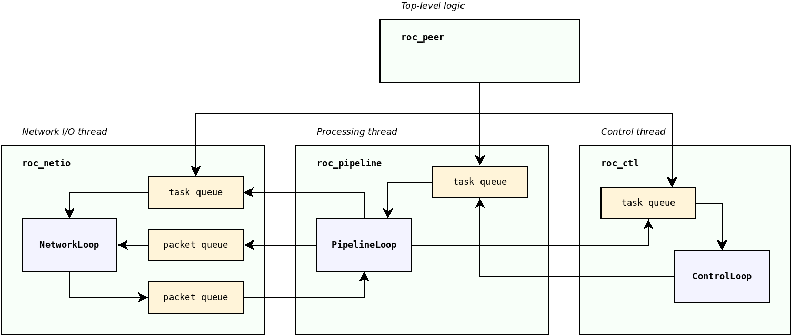

Threads and queues
******************

.. contents:: Table of contents:
   :local:
   :depth: 1

Threads
=======

Roc senders and receivers typically employ several threads.

* **Network I/O thread**

  Network event loop thread. Sends packets from outgoing queue. Receives packets and stores into incoming queue.

  Implemented by `NetworkLoop <https://roc-streaming.org/toolkit/doxygen/classroc_1_1netio_1_1NetworkLoop.html>`_ class from ``roc_netio`` module.

* **Sound I/O thread**

  Audio input or output thread. Sends audio frames to sound card, or receives frames from it.

  Implemented by `sinks <https://roc-streaming.org/toolkit/doxygen/classroc_1_1sndio_1_1ISink.html>`_ and `sources <https://roc-streaming.org/toolkit/doxygen/classroc_1_1sndio_1_1ISource.html>`_ from ``roc_sndio`` module.

* **Pipeline thread**

  Processing thread. Converts a stream of network packets into a stream of audio frames (on receiver), or vice versa (on sender).

  Implemented by `PipelineLoop <https://roc-streaming.org/toolkit/doxygen/classroc_1_1pipeline_1_1PipelineLoop.html>`_ and its derived classes from ``roc_pipeline`` module.

  Note that "pipeline thread" denotes a role rather than a thread created by the pipeline itself. ``PipelineLoop`` does not spawn any thread; whatever thread invokes frame reading or writing plays this role for the duration of the call. See `Thread ownership`_.

* **Control thread**

  Control task event loop. Executes asynchronous tasks for signaling protocols and background work.

  Implemented by `ControlLoop <https://roc-streaming.org/toolkit/doxygen/classroc_1_1ctl_1_1ControlLoop.html>`_ class from ``roc_ctl`` module.

Depending on sound system in use, sound I/O thread and pipeline thread may be the same thread. For example, on ALSA a single thread performs audio I/O and processing, and on PulseAudio, there are separate threads for I/O and processing.

When the user uses ``roc_sender`` or ``roc_receiver`` from the :doc:`C library </api/reference>`, Roc does not manage sound I/O. It also does not create dedicated pipeline thread - instead, the user invokes pipeline processing on their own thread.

Network and control threads belong to context. Sound I/O and pipeline threads, in contrast, belong to node (sender or receiver). When multiple nodes share a single context, they, among other things, share network and control threads as well. The user is free to decide whether to use one context for everything or create an individual context for each node.

Thread ownership
================

It is important to distinguish between a thread role, as described above, and the object that actually creates and owns an operating system thread.

`Context <https://roc-streaming.org/toolkit/doxygen/classroc_1_1node_1_1Context.html>`_ from ``roc_node`` module owns exactly one network thread and one control thread, created together with the context and shared by every node attached to it. Both are started unconditionally: the control thread is not optional, even when no signaling protocol is used, because it is also the place where deferred pipeline work is executed, as described in the next section.

Node owns the sound I/O thread, but only when Roc is responsible for sound I/O, which is the case for command-line tools. When the :doc:`C library </api/reference>` is used, sound I/O is up to the user and Roc creates no such thread.

Pipeline, unlike the other three roles, never creates a thread. `PipelineLoop <https://roc-streaming.org/toolkit/doxygen/classroc_1_1pipeline_1_1PipelineLoop.html>`_ is passive and runs in the thread that calls it, which is different in each deployment:

* in command-line tools, frames are moved between sound I/O and pipeline by a pump running in the tool's own thread

* with ``roc_sender`` and ``roc_receiver`` from the C library, the pipeline is invoked directly from the user's audio thread

* with ``roc_sender_encoder`` and ``roc_receiver_decoder``, there is no sound I/O and no network I/O at all, and the pipeline is driven by the user in whatever way the user's application needs

This design keeps thread layout a decision of the application rather than of the library. Its main consequence is that the pipeline can't wake itself up: if it has work that should be done later, it has to ask someone else to call it back. This is what connects the pipeline to the control thread.

How the loops are connected
===========================

The only outward dependency of the pipeline is `IPipelineTaskScheduler <https://roc-streaming.org/toolkit/doxygen/classroc_1_1pipeline_1_1IPipelineTaskScheduler.html>`_. It has just two operations: schedule pipeline task processing at a given deadline, and cancel a previously scheduled processing. Deadlines are absolute timestamps on the monotonic clock; a zero deadline means "as soon as possible".

The interface is implemented by node classes (sender, receiver, encoder, decoder), and all of them implement it the same way: by scheduling a permanently pre-allocated pipeline processing task on the context's `ControlLoop <https://roc-streaming.org/toolkit/doxygen/classroc_1_1ctl_1_1ControlLoop.html>`_. When the deadline comes, the control thread executes that task, which calls back into the pipeline and asks it to process its pending tasks. So, while pipeline and control loops know nothing about each other, the node glues them together, and the control thread becomes the pipeline's fallback worker.

As a result, a task scheduled on the pipeline may be executed in one of three places:

* **In place**, on the thread that scheduled it. This happens if the pipeline is not busy processing a frame right now (which is detected without blocking), and if we're not too close to the deadline of the next frame.

* **In between frames**, on the thread that reads or writes frames. Before and after a frame, and also in between sub-frames if frame splitting is enabled, the pipeline checks its task queue and processes pending tasks.

* **On the control thread**, if neither of the above happened in time. In this case the pipeline asks the scheduler for a wake-up and the control thread performs the processing.

Whatever path is taken, the task is executed exactly once, and all pipeline state, both frames and tasks, is serialized by a single mutex. The crucial part is who may block on that mutex: only frame reading and writing does. Task scheduling, task processing on the control thread, and cancellation all use non-blocking lock attempts and give way to the frame processing path if the pipeline is busy. Hence a thread that schedules a task, including the network and control threads, can never delay the real-time thread that carries frames.

Precise task scheduling
-----------------------

Executing a task in between frames is cheap, but it is not free, and a task that runs right before the next frame is due may cause a glitch. To mitigate this, ``PipelineLoop`` implements what is called precise task scheduling, enabled by default and configurable via `PipelineLoopConfig <https://roc-streaming.org/toolkit/doxygen/structroc_1_1pipeline_1_1PipelineLoopConfig.html>`_:

* the pipeline keeps track of the deadline of the next expected frame, reported by the sound I/O thread

* long frames are split into smaller sub-frames, so that there are more gaps available for task processing, and no gap is too long

* the total time spent on tasks within one frame is limited

* tasks are not started within a small interval around the next frame deadline; if a task arrives during that interval, its processing is deferred to the control thread and scheduled right after the interval ends

The goal of all this is that when the sound I/O thread calls the pipeline, the pipeline is already free and the call returns without waiting. If precise task scheduling is disabled, tasks are processed only in between whole frames and in place, which is simpler but less friendly to low latency.

Queues
======

Threads in Roc typically don't have a lot of shared state. They are very isolated and communicate only via packet, frame, or task queues. With this approach, most components do not have to bother with synchronization.

The queues between threads are usually lock-free and on some platforms also wait-free, which helps to avoid priority inversion problems (when real-time or high-priority thread is blocked or delayed by low-priority threads).

For example, pipeline thread can enqueue a packet for sending on network thread, or schedule a task for execution on control thread, without a risk of being blocked by network and control threads. This is essential to avoid glitches and maintain low latency.

The diagram below illustrates major threads and connections between them.

Tasks
=====

Network thread, pipeline thread, and control thread, all provide task-based interface to perform control and configuration operations.

For example, when we want network thread to bind a port, or pipeline thread to create an endpoint, we should allocate a corresponding task object and schedule it for execution on relevant thread. We can then wait until task is complete, or register a completion callback.

While all these threads provide similar task-based interface, the underlying implementation is different:

* network thread runs an event loop, and supports multiplexing socket I/O and execution of tasks

* pipeline thread runs processing loop, and is capable of running tasks during gaps between frames, to ensure that execution of tasks won't introduce processing delays and glitches

* control thread is dedicated entirely for task processing and implements advanced interfaces like scheduling tasks with specific deadline, canceling tasks, pausing and resuming tasks, etc.

The allocation and deallocation of a task is responsibility of the caller. For each public operation, there is a task class defined. The caller should create an instance of that class, set its parameters, and schedule the task. The caller is responsible to ensure that the task is alive until completion callback is invoked.

This approach allows to make task scheduling zero-copy and zero-allocation in most cases. Typically the task object can be embedded into a larger owner object, e.g. control task may be embedded into control endpoint object that needs this task.

Given that task queues are based on intrusive containers (e.g. lists and heaps), enqueuing a pre-allocated task does not require making any allocations or copies and is very cheap. This as well helps to keep scheduling operations lock-free.

A single user-level operation is often split into several tasks addressed to different threads. For example, binding a receiver endpoint, on the thread that called the API, consists of the following steps:

* resolve the endpoint address - a network thread task
* create and bind a UDP port - a network thread task
* add the endpoint to the pipeline, which returns a writer for inbound packets - a pipeline task
* start reading from the UDP port into that writer - a network thread task

Each step is scheduled and awaited synchronously, so the calling thread blocks while every piece of work is performed by the thread that owns the corresponding state. Nothing of that state is touched by the calling thread directly.

Putting it together
===================

The following walkthroughs show which thread does what on the hot path. On receiver, a packet becomes a frame:

* the network thread receives a datagram and, without parsing it, pushes the packet into the endpoint's lock-free inbound queue

* the pipeline thread, when the sound I/O thread asks for the next frame, fetches packets from inbound queues, parses and routes them to sessions, and then reads a frame through the depacketizer, FEC decoder, resampler, and mixer

* the sound I/O thread passes the frame to the sound card

On sender, a frame becomes a packet:

* the sound I/O thread obtains a frame from the sound card

* the pipeline thread passes the frame through the session pipeline, splits it into packets, encodes FEC, and hands the packets over to the network port, which enqueues them and wakes up the network event loop

* the network thread sends the packets

In both cases the boundary between the real-time part and the I/O part is a lock-free queue, and the thread that carries frames never blocks on a socket or on another thread.
